# Praktikum 4 

## Membuat CSS	Layout
<b>Tugas ini dibuat untuk memenuhi praktikum 4 dari mata kuliah pemrograman web</b>

### 1. Membuat Dokumen HTML    
<i>Contoh pada gambar dibawah ini (bentuk gambar codingan dan juga browernya)</i>

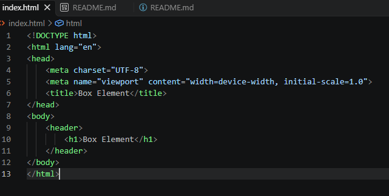
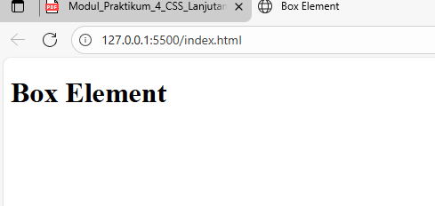

### 2. Membuat	Box	Element
Kemudian tambahkan kode untuk membuat box element dengan tag div seperti berikut
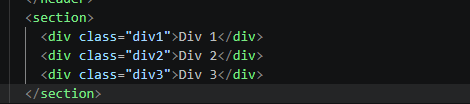
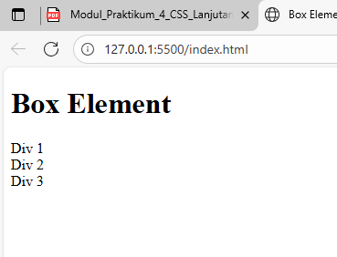

### 3. CSS	Float	Property	
Selanjutnya tambahkan deklarasi CSS pada head untuk membuat float element, seperti 
berikut. 
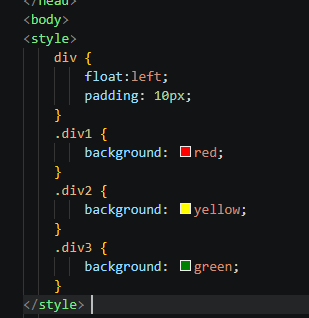
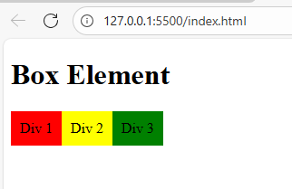

### 4. Mengatur	Clearfix Element
<b>Clearfix</b> digunakan untuk mengatur element setelah float element. Property clear digunakan 
untuk mengaturnya. 
 Tambahkan element div lainnya seteleah div3 seperti berikut. 
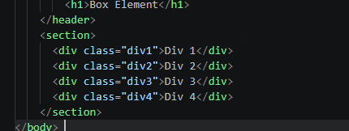
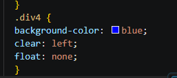
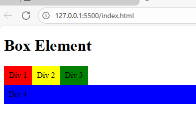

### 5. Membuat Lyout Sederhana

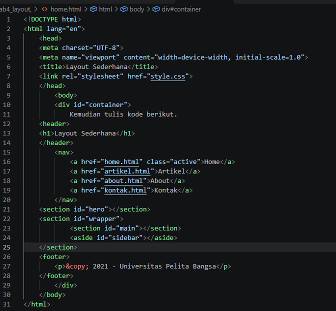
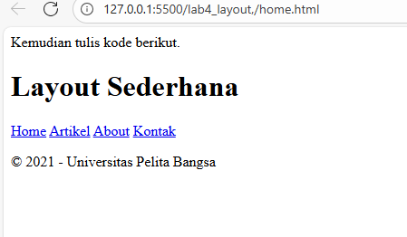

Kemudian tambahkan kode CSS untuk membuat layoutnya. 

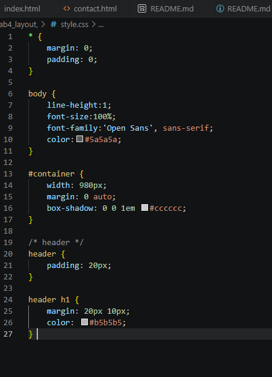
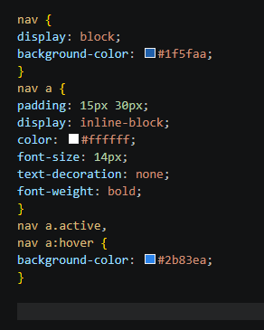

Kemudian lihat hasilnya. 

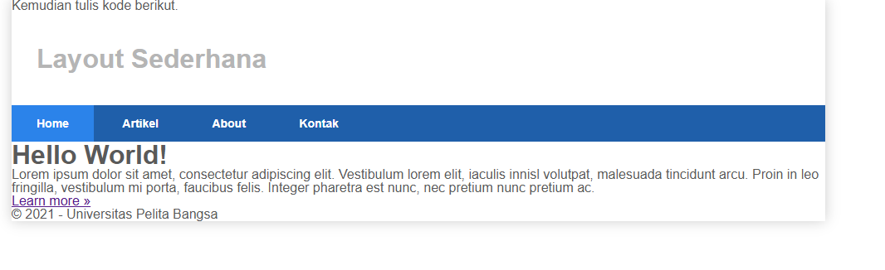

### 6. Membuat	Hero Panel.	
Selanjutnya membuat hero panel. Tambahkan kode HTML dan CSS seperti berikut.

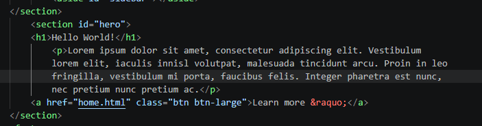
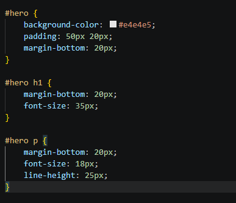

Tampilan Hero Panel. 

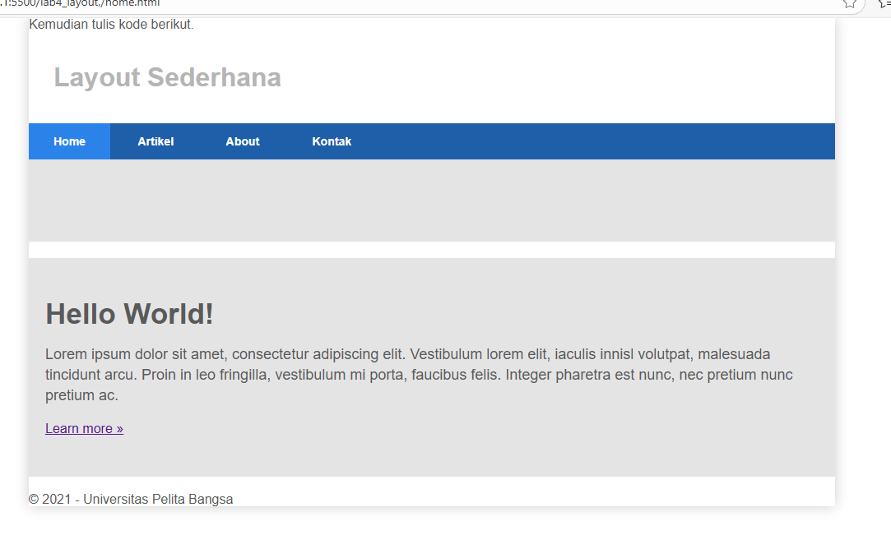

### 7. Membuat	Sidebar	Widget	
Kemudian selanjutnya menambahkan element lain dalam sidebar. 

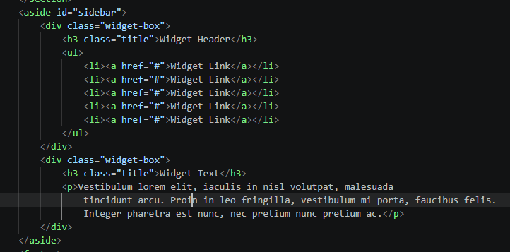

Kemudian tambahkan cssnya

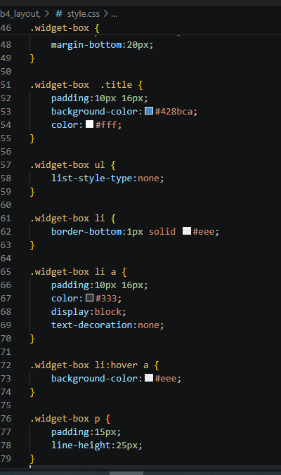
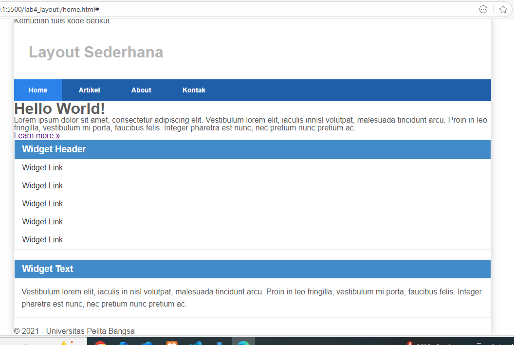

### 8. Mengatur	Footer	
Selanjutnya mengatur tampilan footer. Tambahkan CSS untuk footer.

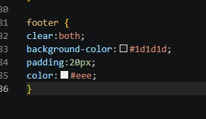
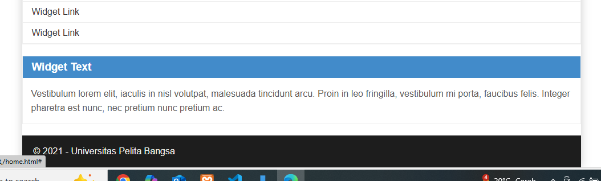

### 9. Menambahkan	Elemen	lainnya	pada	Main	Content	
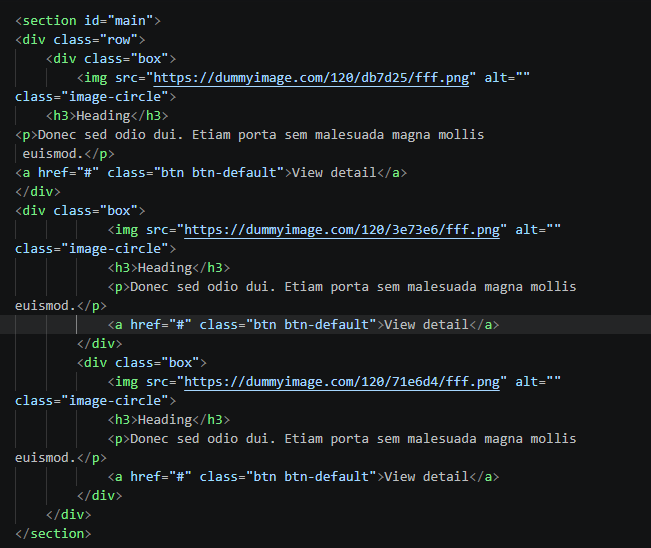

CSS

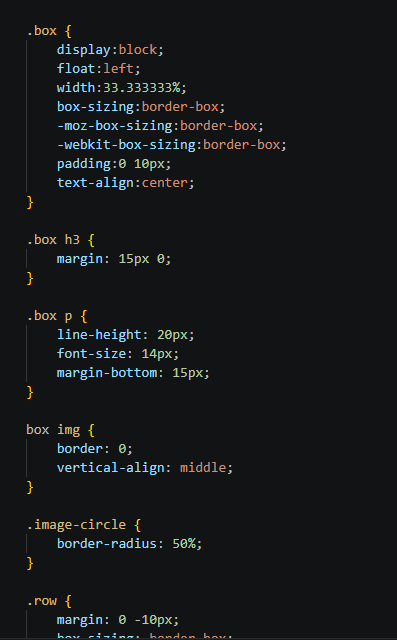
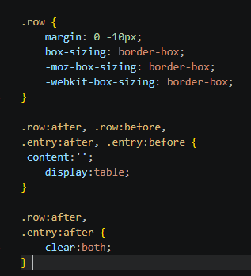

HASIL
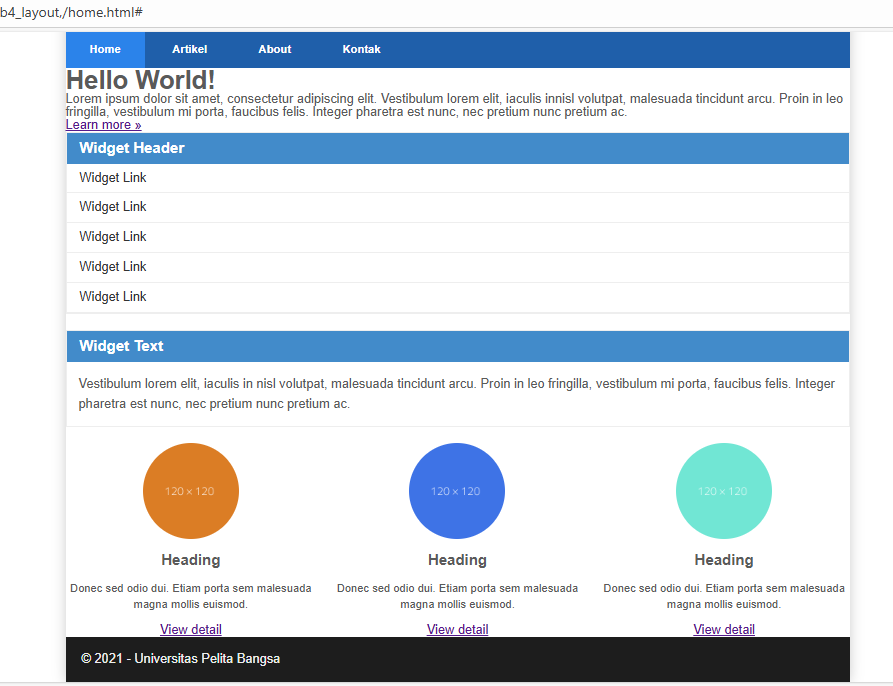

### 10. Menambahkan	Content	Artikel	
Selanjutnya membuat content artikel. Tambahkan HTML berikut pada main content.
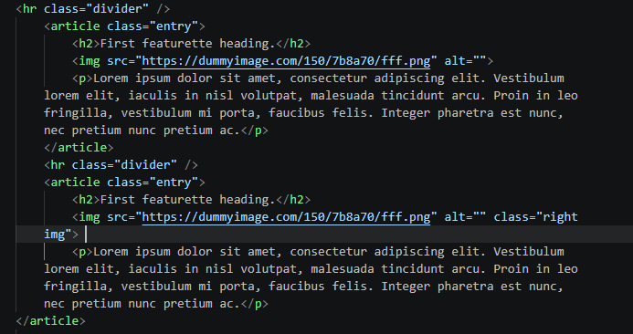
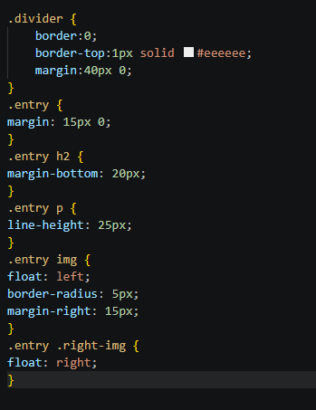

Hasilnya

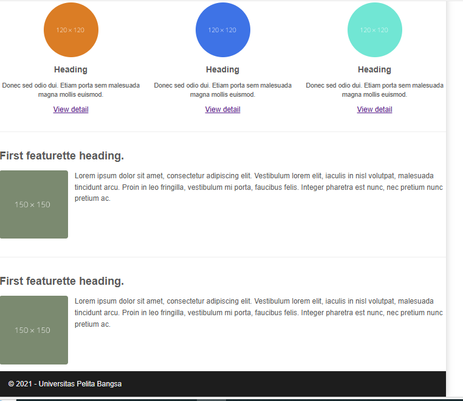